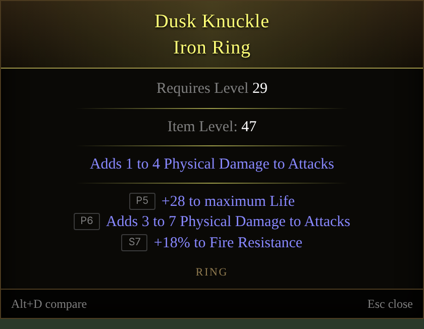
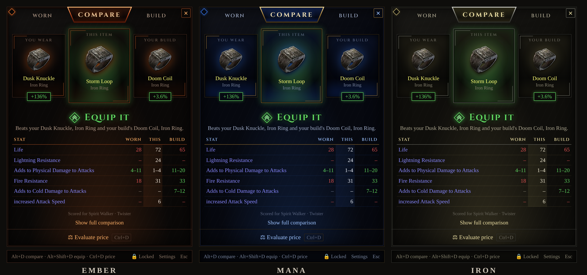
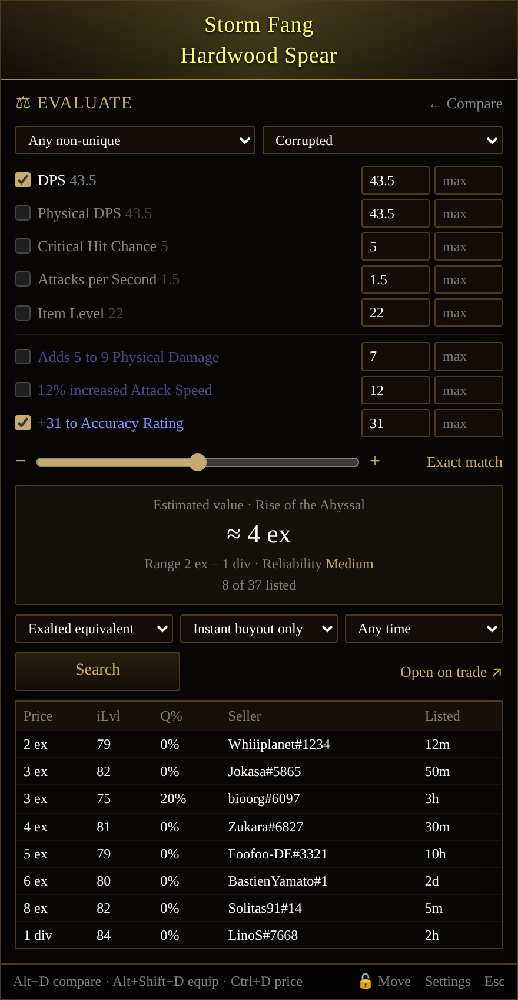

# Divine Mirror

**Is this item an upgrade?** Hover it in Path of Exile 2, press **Alt+Z**, and find out without leaving the game.

<p align="center">
  
</p>

Divine Mirror is a small overlay for Path of Exile 2. It shows the item under your cursor next to what you have equipped, stat by stat, and tells you whether it's an upgrade.

**Website:** [poe-divine-mirror.vercel.app](https://poe-divine-mirror.vercel.app/)

> **Tip:** add your build under **Settings → Build** so the upgrade score cares about the stats your build actually uses. Without one, it uses sensible general weights (life, resistances, damage and so on).

---

## Install

1. Go to the [**Releases**](https://github.com/kristofferkjelde/poe-item-checker/releases/latest) page.
2. Download `Divine-Mirror-Setup-x.y.z.exe` and run it.
3. Windows may show **"Windows protected your PC"** because the app isn't code-signed. Click **More info → Run anyway**.

The app starts in the system tray (bottom-right, near the clock). Hover the icon to see your version, and right-click it to quit.

**Updates:** the app checks for a new release when it starts and every few hours. When one is out you get a notification; click it (or **Update to x.y.z** in the tray menu) to download, then **Restart to update**. Versions before 0.5.0 can't update themselves, so install 0.5.0 by hand once.

**Requirements:** Windows 10 or 11.

## Set up the game

In Path of Exile 2, open **Options → Graphics** and set **Display Mode** to **Windowed Fullscreen** (or **Windowed**). In exclusive **Fullscreen**, nothing can draw on top of the game.

## Use it

| Do this | What happens |
| --- | --- |
| Hover an item you're **wearing** and press **Alt+Shift+Z** | It's saved as your equipped item for that slot (do this once per slot) |
| Hover any other item and press **Alt+Z** | It pops up in the middle of the screen next to the item you wear and your build's item, with a verdict (such as **Equip it** or **Keep yours**) and every stat that changes |
| Hover an item and press **Ctrl+Alt+Z** | The popup shows an Evaluate view: tick the stats that matter, search the official trade site and see what similar items sell for |
| Press **Esc** or click anywhere outside the popup | The popup closes. The game keeps keyboard focus while the popup is open, so you can keep playing and press the hotkey on the next item straight away |
| Drag the popup by its bottom bar | It opens there from now on. Click **🔓 Move** in its footer to lock it (**🔒 Locked**), or use **Settings → Overlay** to lock it or center it again |
| Right-click the tray icon → **Settings…** (or double-click the icon) | Add your build, change the hotkeys (click one and press the new keys), or pick a theme: Ember, Mana or Iron |
| Right-click the tray icon → **Quit** | The app closes |

Works anywhere you can hover an item: your inventory, stash, vendors, or the ground.

**Add your build**

1. Get your build's Path of Building code. On **Mobalytics**, open the build and click **Copy Code** next to Path of Building. In **Path of Building**, use **Import/Export Build → Generate**. A **pobb.in**, **poe.ninja** or **Maxroll** link works too.
2. Open **Settings**, paste it under **Build**, and click **Import build**.
3. If the build has gear stages, pick yours under **Gear stage**. Mobalytics often leaves some stages' gear out of the Path of Building code. To fix that, click **Download Build File** on the build page and add the zip under **Stage gear files**. Each stage then uses exactly the items from its .build file.

The app reads the build's gear, main skill and defences. It then boosts the stats your build uses (★ in the list) and ignores ones it doesn't, such as cast speed on an attack build or energy shield on an evasion build. You can change any number in the list to fine-tune it.

With a build added, **Alt+Z** also compares the item against your build's item for that slot, so you can see how close it gets to the build's gear. The popup shows the item you wear, the new item and your build's item side by side. Click **Show full comparison** for every stat and the full item text.

**Pick a theme**

Open **Settings → Theme** and choose **Ember** (glowing embers on obsidian), **Mana** (a sapphire glow in a bronze frame, like the mana globe) or **Iron** (gunmetal and pale gold, like the in-game menu). Every window follows the theme you pick.

<p align="center">
  
</p>

**Check the price**

Press **Ctrl+Alt+Z** on an item, or click **⚖ Evaluate price** at the bottom of any popup. With a popup already open, **Ctrl+Alt+Z** switches it to Evaluate unless you're hovering a different item in the game. The popup switches to an Evaluate view, like PoE Overlay's:

<p align="center">
  
</p>

- Every property (DPS, defences, item level, quality, rune sockets) and mod gets a row with a checkbox and **min**/**max** boxes. Tick the ones that matter and adjust the numbers. Mods the trade site can't search for are shown in italics.
- The **range slider** starts at **Exact match** (your item's own values as the minimums) and moves every minimum down or up in 5% steps, from −50% to +50%. Click the label to go back to exact.
- Pick the rarity, corrupted state, currency, **Instant buyout** or **In person** listings, and how recently they were listed.
- Press **Search** (or Enter). You get an **estimated value** (the middle of the cheapest listings, with the range and how reliable it is), the cheapest listings with item level, quality, seller and when they were listed, and **Open on trade ↗** to continue in your browser.

The first search runs automatically with sensible defaults. Weapons are matched on DPS and armour on its defences, so their local mods start unticked. Normal items are priced as crafting bases by item level. Uniques are searched by name. Pick another league under **Settings → Trade**. The trade site limits how often anyone can search, so if you search a lot in a row, the popup asks you to wait a few seconds.

**Reading the popup**

- The **verdict** at the top adds up every stat difference, weighted by how much it matters to your build (or in general, if you haven't added one). The percentage next to it is how much better or worse the new item is overall, e.g. **+57%**. Within ±2% counts as a sidegrade.
- The table lists each stat that changes: what you have **now**, what the **new** item has, and the difference in green or red. Greyed-out rows aren't counted in the score yet.
- Rings compare against whichever of your two rings is weaker, since that's the one you'd swap out.
- Saved gear survives restarts. Click **✕ Forget** next to "vs your …" to forget that one item, or right-click the tray icon → **Clear saved gear** to start over.
- **P1–P6 / S1–S7** badges show whether a mod is a **P**refix or **S**uffix and its tier. Tier 1 is the best roll. T1 and T2 are highlighted.
- Mod colors match the game: blue for normal mods, light blue for runes, red for corrupted.

## Is it safe? Will I get banned?

The app follows the same rules as popular tools like PoE Overlay and Exiled Exchange:

- It **never reads or changes game memory or files**.
- Each hotkey press sends **one** keypress to the game (Ctrl+Alt+C, the game's own "copy item" shortcut), which is what GGG allows.
- Price checks only make normal searches on the public trade site, the same as you would in your browser, and respect its rate limits.
- It doesn't automate gameplay in any way.

Your clipboard is put back the way it was right after the item is read.

## Troubleshooting

**Nothing happens when I press Alt+Z**
- Check that the tray icon is there. Hover it: if it says a hotkey is taken, another app (often another overlay) already uses it. Open **Settings…** from the tray and pick a different combination. The Settings window also opens by itself when this happens.
- Make sure your mouse is actually over an item and the game window is focused.
- If the popup says **Couldn't read an item**, the game didn't copy anything. Hover the item and press the hotkey again. In a busy map it can help to hold the keys a moment longer.

**The popup appears behind the game**
- Switch the game to **Windowed Fullscreen** (see [Set up the game](#set-up-the-game)).

**An item looks wrong**
- Hover it, press **Ctrl+Alt+C** in game, paste the text into a [new issue](https://github.com/kristofferkjelde/poe-item-checker/issues/new), and say what's off.

## Roadmap

- [x] **Overlay:** hotkey, item reading, tooltip with mod tiers
- [x] **Build profile:** paste a Path of Building code or build link so the app knows which stats matter to you
- [x] **Remember your gear:** mark the items you're wearing once, per slot
- [x] **Compare on hover:** stat-by-stat differences against your equipped item, plus an overall upgrade score
- [ ] **Import your gear:** fetch what your character is wearing from your pathofexile.com profile
- [x] **Price check:** search the trade site for similar items and show what they sell for

---

## For developers

Built with Electron, React 19, TypeScript and Vite ([electron-vite](https://electron-vite.org)). Requires Node 24+. The hotkey and overlay only work on Windows, but the UI and tests run anywhere.

```sh
npm install        # also downloads Electron
npm run dev        # start the overlay with hot reload
npm start          # build and start it like the installed app (fast; use this to test)
npm test           # item parser tests
npm run typecheck
npm run dist       # build a Windows installer into release/
```

| Folder | What's inside |
| --- | --- |
| `src/main` | Electron main process: hotkey, clipboard capture, overlay window |
| `src/preload` | The small typed bridge between the window and the main process |
| `src/renderer` | React UI styled like the in-game tooltip |
| `src/shared/item` | Item text parser and types, unit tested against real item text |
| `src/shared/compare` | Stat extraction, weights, and the upgrade comparison |
| `src/shared/build` | Path of Building parsing and build-based weights |

**Releasing:** bump `version` in `package.json`, then push a tag like `v0.1.0`. GitHub Actions builds the Windows installer and publishes it on the Releases page.

## Code signing policy

Windows releases are built from this repository by [GitHub Actions](.github/workflows/release.yml) and signed for free by SignPath. Free code signing is provided by [SignPath.io](https://about.signpath.io/), certificate by [SignPath Foundation](https://signpath.org/).

- Committers and reviewers: [Kristoffer Kjelde](https://github.com/kristofferkjelde)
- Approvers: [Kristoffer Kjelde](https://github.com/kristofferkjelde)

## Privacy policy

This program will not transfer any information to other networked systems unless specifically requested by the user or the person installing or operating it. It connects to the internet only for these: a price check sends searches to the official Path of Exile trade site, importing a build fetches the link you paste, showing an item loads its picture (item art from GitHub, currency icons from the trade site's image server), and the update check asks GitHub for the latest Divine Mirror release when the app starts and every few hours. Your settings, saved gear and build stay on your PC.

## License

[MIT](LICENSE)

## Credits

Inspired by [PoE Overlay](https://github.com/PoE-Overlay-Community/PoE-Overlay-Community-Fork) and [Exiled Exchange 2](https://github.com/Kvan7/Exiled-Exchange-2). Item art comes from the game files via [RePoE](https://github.com/repoe-fork/poe2) and belongs to Grinding Gear Games. Headings use [Cinzel](https://github.com/NDISCOVER/Cinzel) (SIL Open Font License). Not affiliated with or endorsed by Grinding Gear Games.
